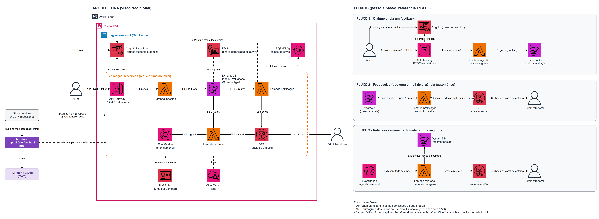

# feedback-infra

Infrastructure (Terraform) for the **Class Feedback Platform** — Tech Challenge phase 4, serverless architecture on AWS.

Students submit `POST /evaluations` with `{"description": string, "score": int 0..10}`.
Administrators receive an urgent-feedback email (low scores) and a weekly report.

## The 4 repositories

| Repository | Responsibility |
|---|---|
| **feedback-infra** (this one) | Terraform for all infrastructure |
| [feedback-lambda-ingestion](../feedback-lambda-ingestion) | Receives the evaluation and writes it to DynamoDB |
| [feedback-lambda-notification](../feedback-lambda-notification) | Notifies admins by email when urgency is high |
| [feedback-lambda-report](../feedback-lambda-report) | Generates and sends the weekly report |

## Architecture



Source: [`docs/architecture.drawio`](docs/architecture.drawio) (open in draw.io).

## Cloud model

**Public cloud (AWS), serverless.** The code runs as functions (FaaS, AWS Lambda) and everything else is a managed service (API Gateway, Cognito, DynamoDB, SES, SQS, EventBridge, CloudWatch).

- **Pay per use:** no server running idle, which fits the limited cloud credits.
- **Nothing to operate:** AWS handles servers, scaling, patching and availability.
- **Single responsibility:** one function per job (ingestion, notification, report), each in its own repository with its own pipeline and permissions.
- **Event driven:** an HTTP request, a DynamoDB stream record or a weekly schedule starts each function.

## Resources

| File | What it creates |
|---|---|
| `api.tf` | HTTP API with the `POST /evaluations` route, Cognito JWT authorizer and throttling (1 req/s) |
| `cognito.tf` | User pool (email login, admin-created users only), public app client, groups `students` and `admins` |
| `dynamodb.tf` | `Evaluations` table (on-demand, capped throughput, PITR, stream `NEW_IMAGE`) and `by-day` index |
| `lambdas.tf` | The 3 functions, their least-privilege policies, the stream trigger (filtered) and its DLQ |
| `scheduler.tf` | EventBridge rule `cron(0 11 ? * MON *)` — every Monday 08:00 Brasília time |
| `ses.tf` | SES identities for the sender and the admins (account in sandbox, each address must be verified) |
| `iam.tf` | GitHub OIDC provider and pipeline roles (see below) |
| `modules/lambda-function/` | Reusable module: function (Java 21), IAM role, log group (14-day retention) |

The functions are created with placeholder code. Each lambda repository publishes its own code with `lambda:UpdateFunctionCode`, and Terraform ignores code changes afterwards.

## Data contract

Table **`Evaluations`** — partition key `evaluationId` (string, UUID).

| Attribute | Type | Description |
|---|---|---|
| `evaluationId` | string | UUID v4 |
| `userId` | string | Cognito `sub` |
| `description` | string | Evaluation text (max 1000 characters) |
| `score` | number | Integer from 0 to 10 |
| `urgency` | string | `high` (0-3), `medium` (4-6), `low` (7-10) |
| `submittedAt` | string | ISO 8601, UTC |
| `day` | string | YYYY-MM-DD, America/Sao_Paulo (fixed UTC-3) |

Index **`by-day`**: partition key `day`, sort key `submittedAt` (projects `description`, `score`, `urgency`; `userId` is left out on purpose).

## Security and cost

- **No static AWS keys:** all pipelines authenticate through GitHub OIDC.
  - `feedback-github-infra-plan` — pull requests, read-only.
  - `feedback-github-infra-apply` — `main` branch, limited to the services this project uses.
  - `feedback-github-lambda-*` — one per lambda repository, only `lambda:UpdateFunctionCode` on its own function.
- **Authentication:** only users created by an admin can log in (Cognito, no self sign-up); the API rejects requests without a valid JWT. Users are split into the `students` and `admins` groups.
- **Least privilege:** each function has its own role (e.g. ingestion can only `PutItem`, report can only `Query` the index).
- **Data protection:** the table is encrypted at rest (AWS managed key `aws/dynamodb`) and has point-in-time recovery; the report index leaves `userId` out.
- **Cost guards:** pay-per-use only (no idle hourly cost), API throttling, DynamoDB throughput cap, limited stream retries, short log retention. A monthly AWS Budget alert is configured in the console, outside Terraform.
- **LGPD:** email addresses are never committed; they come from GitHub secrets and are masked in the pipeline logs.

## Monitoring

Amazon CloudWatch, with what AWS provides out of the box (no extra cost):

| What | Where in CloudWatch |
|---|---|
| Function logs | Log groups `/aws/lambda/feedback-ingestion`, `/aws/lambda/feedback-notification`, `/aws/lambda/feedback-report`, created by Terraform with 14-day retention. Logs hold only ids, counts and error types (LGPD). |
| Function metrics | `AWS/Lambda`: `Invocations`, `Errors`, `Duration`, `Throttles` per function; `IteratorAge` for the stream trigger |
| API metrics | `AWS/ApiGateway`: `Count`, `4xx`, `5xx`, `Latency` |
| Table metrics | `AWS/DynamoDB`: consumed capacity and throttled requests |
| Failed notifications | `AWS/SQS`: `ApproximateNumberOfMessagesVisible` on `feedback-notification-dlq` (events the notification function could not process) |

Logs can also be followed from the terminal:

```bash
aws logs tail /aws/lambda/feedback-ingestion --follow
```

## Pipelines

| Workflow | Trigger | Steps |
|---|---|---|
| `ci.yml` | Pull request to `main` | `fmt -check`, `validate`, `plan` |
| `deploy.yml` | Push to `main` | `apply` |

State is stored in Terraform Cloud (organization `feedback-tc-ana`, workspace `feedback-infra`).

Required GitHub configuration:

| Name | Type | Content |
|---|---|---|
| `TF_API_TOKEN` | secret | Terraform Cloud token |
| `SES_SENDER_EMAIL` | secret | Sender address |
| `ADMIN_EMAILS` | secret | JSON list of admin addresses |
| `AWS_PLAN_ROLE_ARN` | variable | Output `infra_plan_role_arn` |
| `AWS_APPLY_ROLE_ARN` | variable | Output `infra_apply_role_arn` |

## Deploy from scratch

1. **First apply (local, once).** The pipeline roles don't exist yet, so the first apply uses your own AWS credentials (admin) and a Terraform Cloud login:

   ```bash
   # terraform.tfvars (gitignored)
   # ses_sender_email = "sender@example.com"
   # admin_emails     = ["admin@example.com"]

   terraform login
   terraform init
   terraform apply
   ```

2. **Verify the emails in SES.** SES sends a verification link to the sender and to each admin; click each one (the account is in the SES sandbox).
3. **Configure GitHub.**
   - `feedback-infra`: the secrets and variables in [Pipelines](#pipelines).
   - Each lambda repository: variable `AWS_ROLE_ARN` with its entry from `terraform output function_pipeline_role_arns`.
4. **Publish the function code.** Push to `main` (or re-run the workflow) in the 3 lambda repositories.
5. **Create the users** (admins also need a verified email in SES to receive emails):

   ```bash
   POOL=$(terraform output -raw cognito_user_pool_id)

   aws cognito-idp admin-create-user --user-pool-id "$POOL" --username student@example.com      --user-attributes Name=email,Value=student@example.com Name=email_verified,Value=true      --message-action SUPPRESS
   aws cognito-idp admin-set-user-password --user-pool-id "$POOL" --username student@example.com      --password '<password>' --permanent
   aws cognito-idp admin-add-user-to-group --user-pool-id "$POOL" --username student@example.com      --group-name students
   ```

   Repeat with `--group-name admins` for each administrator.

6. **Test the API:**

   ```bash
   CLIENT=$(terraform output -raw cognito_app_client_id)
   API=$(terraform output -raw api_url)

   TOKEN=$(aws cognito-idp admin-initiate-auth --user-pool-id "$POOL" --client-id "$CLIENT"      --auth-flow ADMIN_USER_PASSWORD_AUTH      --auth-parameters USERNAME=student@example.com,PASSWORD='<password>'      --query AuthenticationResult.IdToken --output text)

   curl -X POST "${API%/}/evaluations" -H "Authorization: Bearer $TOKEN"      -H "Content-Type: application/json" -d '{"description": "Class audio was cut off", "score": 2}'
   ```

   A score from 0 to 3 triggers the urgency email. To run the weekly report without waiting for Monday:

   ```bash
   aws lambda invoke --function-name feedback-report out.json
   ```

After this, every change goes through the pipelines: pull request → `plan`, merge to `main` → `apply`.

Region `sa-east-1`. All resources use the `feedback-` prefix and the tags `Project=feedback`, `Environment=dev`, `ManagedBy=terraform`.
